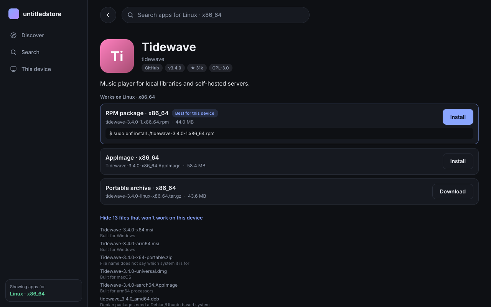

# untitledstore

An app store for **GitHub Releases** and the **AUR**, written in Rust, that only shows
you what actually runs on the machine in front of you.

A release with 18 files becomes one **Install** button: the `.deb` on Ubuntu, the `.rpm`
on Fedora, the pacman package on Arch, the arm64 installer on a Windows-on-Arm laptop,
the right-ABI APK on a phone, the TV build on a TV. Everything else is hidden, and the
store will tell you why if you ask.

| Desktop | Mobile | TV |
|---|---|---|
|  |  |  |

(Screenshots show the built-in demo catalog; the apps in it are fictional.)

## Status

Early, but real: this is a working vertical slice, not a mock-up.

| | State |
|---|---|
| Compatibility engine, GitHub + AUR sources, install planning | Implemented, 43 unit tests |
| Desktop, mobile and TV interfaces | Implemented in one Slint app, exercised headlessly on Linux |
| Linux | Builds and runs |
| Windows, macOS | Core type-checks for these targets; the app has **not** been built or run there yet |
| Android (phone, tablet, TV) | Core type-checks; entry point written; **no APK packaging yet**, and handing APKs to the system installer is not implemented |
| iOS | Detection and `.ipa` handling exist in the core; see the caveats in [docs/DESIGN.md](docs/DESIGN.md#ios) |
| Live GitHub / AUR requests | Written against the documented APIs, but **not yet run against the real services** (the environment this was built in blocks them) |

## Try it

```sh
# The store, with the offline demo catalog
cargo run -p untitledstore -- --demo

# See what another device would be offered
cargo run -p untitledstore -- --demo --as android-tv --ui tv
cargo run -p untitledstore -- --demo --as windows-arm64
cargo run -p untitledstore -- --demo --as android-arm64 --ui mobile --size 412x892

# The same engine without a window
cargo run -p ustore-cli -- device
cargo run -p ustore-cli -- --demo --as linux-x64-arch search lumen
cargo run -p ustore-cli -- --demo --as macos-arm64 show github:kestrel-sh/kestrel
cargo run -p ustore-cli -- classify ripgrep-14.1.0-x86_64-unknown-linux-musl.tar.gz

# Against the real GitHub and AUR (drop --demo). A token raises GitHub's limit
# from 60 to 5,000 requests per hour.
GITHUB_TOKEN=... cargo run -p ustore-cli -- search ripgrep
```

Narrow the desktop window below 700 px and it becomes the mobile interface. TV mode is
driven with the arrow keys, Enter and Escape, which is what a remote's D-pad, OK and
Back buttons send.

Linux build requirements: a C toolchain, `fontconfig`, and at runtime `libxkbcommon`
(plus `libxkbcommon-x11` on X11).

## Layout

```
crates/core   ustore-core    platform detection, asset classification, compatibility,
                             sources (GitHub, AUR), curated index, install planning
crates/cli    ustore         command-line front end
crates/app    untitledstore  Slint app: ui/desktop.slint, ui/mobile.slint, ui/tv.slint
docs/DESIGN.md               the design, its trade-offs, and what is still open
```

## License

`GPL-3.0-only` is declared in `Cargo.toml` as a starting point because the UI toolkit,
Slint, is available under GPLv3 (among other options). See
[the licensing note](docs/DESIGN.md#ui-toolkit) before changing it.
