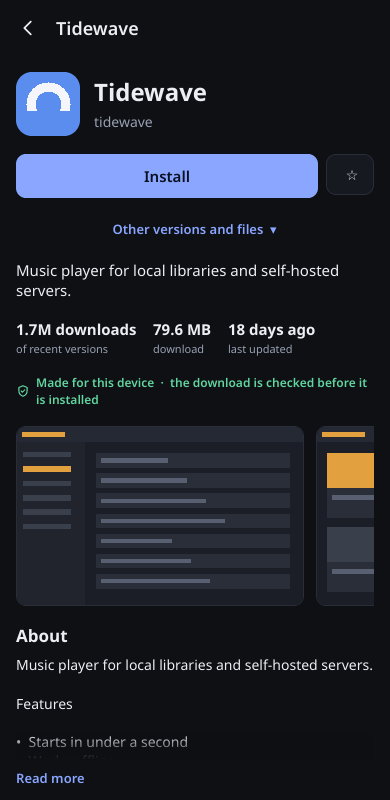

# untitledstore

An app store for **GitHub Releases** and the **AUR**, written in Rust, that only shows
you what actually runs on the machine in front of you.

A release with 18 files becomes one **Install** button: the `.deb` on Ubuntu, the `.rpm`
on Fedora, the pacman package on Arch, the arm64 installer on a Windows-on-Arm laptop,
the right-ABI APK on a phone, the TV build on a TV. Everything else is hidden, and the
store will tell you why if you ask.

It is entirely client-side: no account, no server of ours, no telemetry. The app talks
to GitHub and the AUR directly and keeps your library and settings in one file on your
device.

| Desktop | Mobile | TV |
|---|---|---|
|  |  |  |

More in [`docs/screenshots/`](docs/screenshots): [app page](docs/screenshots/desktop-details.png),
[update](docs/screenshots/desktop-update.png), [library](docs/screenshots/desktop-library.png),
[settings](docs/screenshots/desktop-settings.png), [light theme](docs/screenshots/desktop-light.png),
[first run](docs/screenshots/desktop-welcome.png), [AUR results on Arch](docs/screenshots/desktop-search-arch.png),
[Windows on Arm](docs/screenshots/desktop-windows-arm.png), [TV app page](docs/screenshots/tv-details.png).
Screenshots show the built-in demo catalog; the apps in it are fictional.

## What it does

- **Filters by device**: OS, CPU (including what can be emulated), Linux package format,
  libc, and phone vs TV. Hidden files are listed with the reason on request.
- **Discover, search, or paste a link**: typing suggests featured apps instantly;
  Enter searches the sources; a GitHub URL or `owner/repo` opens that project directly.
- **Installs**: downloads, verifies the SHA-256 GitHub publishes, then places AppImages
  itself or hands packages to the system installer. Shows the steps first; downloads can
  be cancelled. AUR packages get the exact command to run, not a silent build.
- **Library and updates**: remembers what you installed and checks the sources for
  newer releases that fit your device. Older versions can be picked from the app page.
- **Three interfaces** in one app: desktop (mouse and full keyboard use), mobile (touch),
  TV (remote only). Light and dark themes.
- **Works badly-connected**: Discover and suggestions need no network; failed lookups
  say what went wrong and can be retried; cached answers are used when GitHub's
  allowance runs out.
- **Honest about limits**: shows GitHub's remaining request allowance, takes an optional
  token to raise it, says plainly that nothing in the catalog is reviewed, and warns
  about pre-releases, abandoned projects and out-of-date AUR packages.

## Status

A working vertical slice. It has only ever been looked at on Linux.

| | State |
|---|---|
| Engine, sources, library, updates, install planning | Implemented; 139 automated tests in total |
| Desktop, mobile and TV interfaces | Implemented; 40 tests drive the real window headlessly, 6 more run the real binary under a virtual display |
| Linux | Builds, runs, all tests pass |
| Windows, macOS | Builds and the test suite passes on GitHub's Windows and macOS runners. Those tests use a headless backend: **nobody has seen the window on either system**, and installer hand-off there is untried |
| Android (phone, tablet, TV) | Core type-checks; entry point written; **no APK packaging**, and handing APKs to the system installer is not implemented (the UI says so) |
| iOS | Can only ever be a catalog: see [the design notes](docs/DESIGN.md#ios) |
| Live GitHub / AUR requests | Tested over real HTTP against a local server speaking the documented API shapes; **never run against the real services** (blocked where this was built) |

## Try it

```sh
# The store, with the offline demo catalog
cargo run -p untitledstore -- --demo

# See what another device would be offered
cargo run -p untitledstore -- --demo --as android-tv --ui tv
cargo run -p untitledstore -- --demo --as windows-arm64
cargo run -p untitledstore -- --demo --as android-arm64 --ui mobile --size 412x892

# The same engine without a window
cargo run -p ustore-cli -- device
cargo run -p ustore-cli -- --demo --as linux-x64-arch search lumen
cargo run -p ustore-cli -- --demo --as macos-arm64 show github:kestrel-sh/kestrel
cargo run -p ustore-cli -- --demo install github:tidewave/tidewave
cargo run -p ustore-cli -- --demo updates
cargo run -p ustore-cli -- classify ripgrep-14.1.0-x86_64-unknown-linux-musl.tar.gz

# Against the real GitHub and AUR: drop --demo.
cargo run -p ustore-cli -- search ripgrep

# First thing to run on a real connection: checks that GitHub and the AUR answer the way
# the code expects, and that every featured app really has a file for this machine.
cargo run -p ustore-cli -- doctor
```

Keyboard on desktop: `Ctrl+K` or `/` search, `Esc` or `Alt+Left` back, `Tab` and
`Enter` for everything else. Narrow the window below 700 px and it becomes the mobile
interface. TV mode uses the arrow keys, Enter and Escape, which is what a remote's
D-pad, OK and Back buttons send.

Linux build requirements: a C toolchain and `fontconfig`; at runtime `libxkbcommon`
(plus `libxkbcommon-x11` on X11).

## Tests

```sh
cargo test --workspace
```

No internet needed. The network tests start their own server on localhost and the UI
tests use Slint's headless backend. On Linux, six more tests run the real binary under
`xvfb-run` and are skipped if it is not installed. CI runs the suite on Linux, Windows
and macOS. See [Testing](docs/DESIGN.md#8-testing).

## Layout

```
crates/core   ustore-core    platform detection, asset classification, compatibility,
                             sources (GitHub, AUR), index, install, library state
crates/cli    ustore         command-line front end
crates/app    untitledstore  Slint app: ui/desktop.slint, ui/mobile.slint, ui/tv.slint
docs/DESIGN.md               the design, its trade-offs, and what is still open
```

## Where things are stored

| | Linux | Windows | macOS |
|---|---|---|---|
| Settings and library | `~/.config/untitledstore/state.json` | `%APPDATA%\untitledstore` | `~/Library/Application Support/untitledstore` |
| Downloads | `~/Downloads/untitledstore` | same | same |
| AppImages | `~/Applications` | | |
| Cache | `~/.cache/untitledstore` | `%LOCALAPPDATA%\untitledstore` | `~/Library/Caches/untitledstore` |

Only the Linux column has been exercised.

## License

`GPL-3.0-only` is declared in `Cargo.toml` as a starting point because the UI toolkit,
Slint, is available under GPLv3 (among other options). See
[the licensing note](docs/DESIGN.md#10-ui-toolkit) before changing it.
