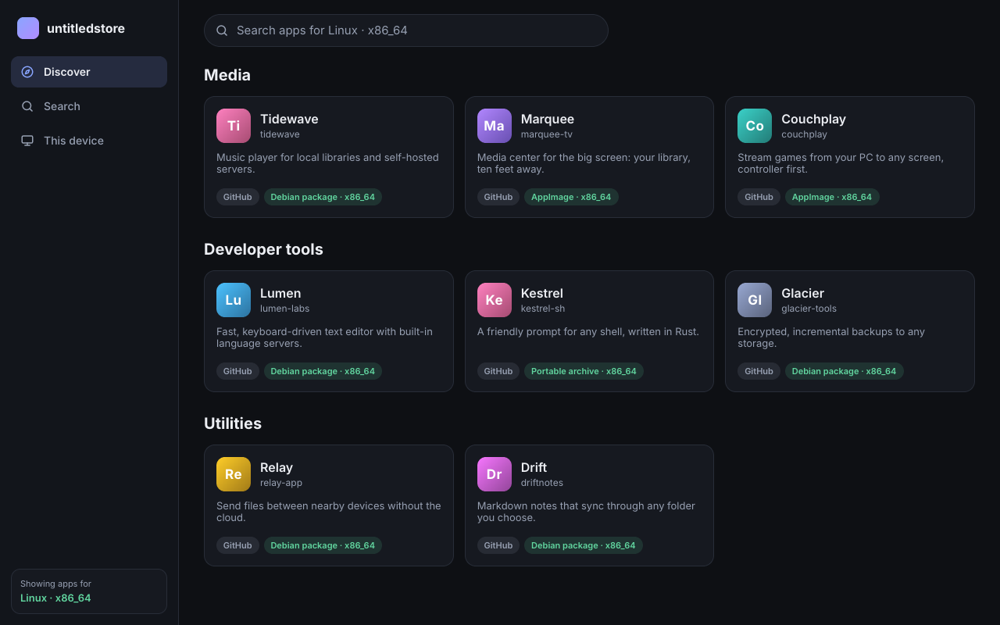
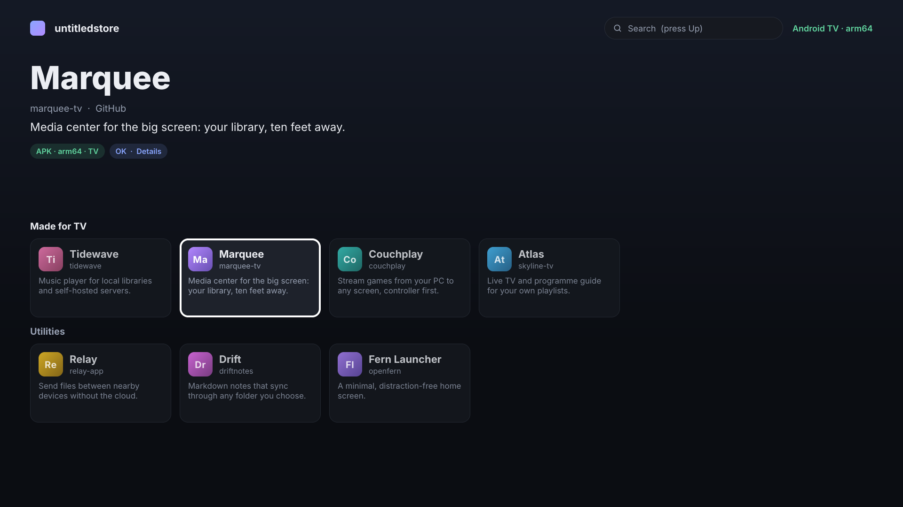

  

<h1 align="center">Bilby</h1>

  <b>An app store for open-source apps that only shows what runs on your device.</b> 
  GitHub Releases, Flathub, Codeberg and your Linux distribution, in one place. 
  No account. No server of ours. No tracking.

  <a href="#download">Download</a> ·
  <a href="#what-you-can-do">What it does</a> ·
  <a href="#where-apps-come-from">Sources</a> ·
  <a href="#how-ready-is-it">Status</a> ·
  <a href="docs/DEVELOPMENT.md">Build it</a>

## The idea

Open-source apps usually hand you a page of download files and leave you to work out
which one is yours.

**Bilby works it out for you.** It looks at your system, your processor and the kind of
device you are on, and turns a release with 18 files into one **Install** button. The
other 17 stay out of the way unless you ask for them.

| On a desktop | On a phone | On a TV |
|:---:|:---:|:---:|
|  |  |  |
| Mouse and keyboard | Touch | Remote only |

The screenshots show the built-in demo catalog. The apps in it are made up.

## Download

Get the newest version from the [releases page](https://github.com/AndrewGBest/Bilby/releases/latest).
One file per system, and each runs as it is:

| Your system | File to download | To start it |
|---|---|---|
| **Linux** (x86_64) | `bilby-…-x86_64.AppImage` | Make it executable (`chmod +x`, or tick "executable" in the file's Properties), then open it |
| **Windows** (x64) | `bilby-…-x86_64-windows.exe` | Open it. Windows will warn about an unknown publisher: choose *More info*, then *Run anyway* |
| **macOS** (Apple silicon) | `bilby-…-aarch64-macos.dmg` | Open it and drag Bilby to Applications. The first time, right-click the app and choose *Open* |

On Linux, Bilby adds itself to your app menu the first time it runs.

> [!NOTE]
> The files are not signed by a registered developer yet, which is what the Windows and
> macOS warnings are about.

There is no Android package yet, and no Flatpak
([why not](docs/DESIGN.md#appearing-among-the-devices-apps)).

## What you can do

**Find an app**

- Browse hand-picked apps, plus what is popular and trending on Flathub.
- Search every source at once. The best match comes first: the app with the name you
  typed, then the ones most people use.
- See what you are getting: pictures, a description, star ratings and written reviews,
  how many people have downloaded it, and whether the developer is verified.

**Install it**

- One button installs the right file for your device.
- Downloads are checked against the checksum the source publishes, when there is one.
- Every other file and every older version is one press away, never hidden for good.

**Keep everything up to date**

- The Library lists what you installed and tells you when something newer is out.
- Update one app or all of them, or skip a version you do not want.
- On Linux, Bilby can update the system itself too, through pacman, apt, dnf and Flatpak.

**Use it from the sofa**

- The TV layout is driven with a remote: arrows, OK and Back.
- On a Linux TV, websites can be added like apps and open in
  [Longboard](https://github.com/AndrewGBest/Longboard), a browser made for remotes.

## Where apps come from

Each source only appears on devices it applies to. A Windows user never sees the AUR.

| Source | Shown on | What you get |
|---|---|---|
| **GitHub Releases** | Everywhere | Any project that publishes files with its releases |
| **Flathub** | Linux with Flatpak | Its whole catalog, with ratings, reviews and install counts |
| **Your distribution** | Arch-based (pacman) and Debian-based (apt) systems | Every package your system is already set up to install |
| **The AUR** | Arch-based systems | Community build recipes |
| **Codeberg** | Everywhere | Projects by link and from the home page. Codeberg is turning away searches at the moment |
| **Websites** | Linux TVs | Sites that open like apps in Longboard |

## Your privacy

Bilby has no server and no account, so there is nobody for it to report to. Your library
and settings are one file on your device. What does leave your device:

| When you | Bilby contacts | It learns |
|---|---|---|
| Search or open an app | That app's source (GitHub, Flathub, ...) | What you searched for or opened, as with any website |
| Have ratings switched on | The ratings service GNOME and KDE use | That *someone* downloaded the full list of ratings, once a day |
| Open an app that has reviews | The same service | Which app's reviews were asked for. No user id is sent |
| Sign in to GitHub | GitHub | Which account is asking. Optional; it only raises GitHub's hourly limit, and Bilby asks for no access to the account |

Ratings and reviews can be switched off in Settings, which stops both requests.

## How ready is it

Bilby works and is being used, but it is early. Plainly:

| | State |
|---|---|
| **Linux** | Works. Tried on Debian 13: real searches on every source and a real install from Flathub |
| **Windows, macOS** | Builds and passes its tests. Nobody has checked the window by eye yet |
| **Android** | Not installable yet. The core compiles for it |
| **iOS** | Could only ever browse, not install ([why](docs/DESIGN.md#ios)) |
| **System updates** | Finds updates correctly on Debian. Installing them has not been run on a real system |
| **Arch, Fedora** | Written from documentation and tested against stand-ins, not on real systems |
| **TV** | Works with arrow keys, OK and Back. Not yet tried with a physical remote |

Nobody reviews the apps in the catalog. Bilby warns about test versions, abandoned
projects and out-of-date packages, but an app is only as trustworthy as its author.

## Good to know

- **GitHub's limit.** Without signing in, GitHub allows 60 requests an hour for
  everyone on your network. Bilby tells you when it runs out. Signing in to GitHub in
  Settings (you type a short code on GitHub's site) raises it to 5,000. Flathub and your distribution's packages have no such limit.
- **Reduce motion.** Settings can turn animations off.
- **From a terminal.** `bilby-cli` does everything the app does, and can export your
  library to move it to another device.

## Learn more

| | |
|---|---|
| [How Bilby compares](docs/COMPARISON.md) | Next to Komi Store, Obtainium, GNOME Software and others, and what it leaves out on purpose |
| [Design notes](docs/DESIGN.md) | How it decides what runs on your device, and every trade-off made along the way |
| [Building and testing](docs/DEVELOPMENT.md) | Run it from source, try it as another device, and work on it |

## Licence

GPL-3.0-only for now. Read [the licensing note](docs/DESIGN.md#10-ui-toolkit) before
relying on that: it was chosen as a starting point and may change.
